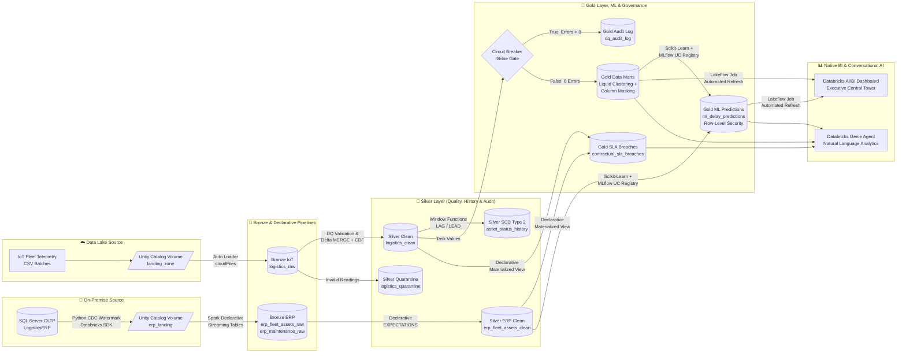

# 🚚 Multi-Source Smart Logistics & Cold-Chain Data Intelligence Platform (Databricks)

End-to-end **Data Engineering, Governance, Machine Learning & Conversational AI** platform built on **Databricks**. This project integrates **on-premise relational ERP data (SQL Server)** with **IoT fleet telemetry (CSV batches)** into a unified **Medallion Lakehouse (Bronze → Silver → Gold)** governed by **Unity Catalog**.

---

## 🏗️ End-to-End Architecture



---

## 🚀 Full-Stack Databricks Capabilities Implemented

### 1. Hybrid Multi-Source Ingestion (On-Premise SQL Server + IoT)
* **Custom On-Premise Extractor (`connectors/sqlserver_to_databricks.py`):** Connects to a local **SQL Server** instance (`LogisticsERP`) via `pyodbc`, tracks incremental changes using a persistent **Watermark (`last_updated_at`)**, and securely uploads delta batches to a **Unity Catalog Managed Volume** using the **Databricks SDK**.
* **Incremental File Ingestion (`02_bronze_autoloader.py`):** Uses **Databricks Auto Loader (`cloudFiles`)** with `trigger(availableNow=True)`, schema evolution, and file-level audit metadata (`_source_file`, `_ingested_at`).

### 2. Spark Declarative Pipelines (formerly Delta Live Tables)
* **Declarative ETL (`08_declarative_erp_iot_pipeline.sql`):** Ingests ERP master data via `STREAMING TABLES`, enforces data quality declaratively using **Expectations** (`CONSTRAINT ... ON VIOLATION DROP ROW`), and joins IoT telemetry with SQL Server SLA contracts in a `MATERIALIZED VIEW` (`contractual_sla_breaches`) to detect cold-chain violations by cargo category.

### 3. Data Quality Quarantine, Circuit Breaker & SCD Type 2
* **Quarantine & Circuit Breaker (`03_silver_dq_and_merge.py` & `05_dq_incident_logger.py`):** Isolates corrupt sensor readings into `logistics_quarantine`, publishes row counts dynamically via `dbutils.jobs.taskValues`, and uses an **`If/else` condition gate** in **Lakeflow Jobs** to halt Gold updates and log audit incidents whenever anomalies are detected.
* **Slowly Changing Dimension Type 2 (`06_silver_asset_scd2.py`):** Tracks historical shipment status (`In Transit` → `Delayed` → `Delivered`) and inventory transitions per asset using PySpark Window functions (`LAG`/`LEAD`) with `effective_from`, `effective_to`, and `is_current` intervals.

### 4. Enterprise Governance & Security (Unity Catalog)
* **Dynamic Column Masking (`07_unity_catalog_masking.sql`):** Masks sensitive financial cargo values (`total_cargo_value`) for users outside the `finance_auditors` group.
* **Row-Level Security (`10_governance_cdf_and_rls.sql`):** Applies row filters (`SET ROW FILTER`) on Gold ML predictions so regional managers only view shipments assigned to their specific hub (`assigned_hub`).
* **Change Data Feed (CDF):** Enables `delta.enableChangeDataFeed = true` on Silver tables for row-level commit auditing via `table_changes()`.
* **End-to-End Automated Lineage:** Full column- and table-level traceability across Volumes, Streaming Tables, Notebooks, Models, and Dashboards.

### 5. Machine Learning, MLOps & Native AI/BI
* **Predictive Delay Scoring (`09_ml_delay_prediction.py`):** Trains a `RandomForestClassifier` combining IoT telemetry and SQL Server SLA thresholds, logs metrics/signatures with **MLflow**, registers the governed model in **Unity Catalog (`logistics_prod.models.delay_risk_predictor`)**, and writes batch delay probabilities to Gold.
* **Databricks AI/BI Dashboard & Genie Agent:** Executive KPIs and ML risk scores are automatically refreshed at the end of the **Lakeflow Job** in an **AI/BI Dashboard** (*Smart Logistics Executive Control Tower*) and exposed to business users for natural-language querying via a **Databricks Genie Agent**.

### 6. Orchestration & Infrastructure as Code (CI/CD)
* **Lakeflow Jobs & Databricks Asset Bundles (`databricks.yml`):** Orchestrates parallel multi-source ingestion, fan-out SCD2 processing, conditional circuit-breaker branching, ML batch scoring, and dashboard refreshes declaratively across `dev` and `prod` targets.

---

## 📂 Repository Structure

```text
databricks-smart-logistics-lakehouse/
├── databricks.yml                            # Databricks Asset Bundle (Job & Pipeline IaC)
├── connectors/
│   └── sqlserver_to_databricks.py            # On-premise SQL Server incremental watermark extractor
├── docs/
│   ├── lakeflow_job_full_dag.png             # End-to-end multi-source & ML Lakeflow Job DAG
│   ├── declarative_pipeline_graph.png        # Spark Declarative Pipeline & Expectations metrics
│   ├── unity_catalog_lineage.png             # Automated end-to-end data lineage
│   └── databricks_aibi_dashboard.png         # Native AI/BI Executive Dashboard
└── src/
    ├── 01_setup_unity_catalog.sql            # Catalog, Medallion schemas & Volumes setup
    ├── 02_bronze_autoloader.py               # Incremental IoT ingestion with Auto Loader
    ├── 03_silver_dq_and_merge.py             # Quarantine routing, Delta MERGE & Task Values
    ├── 04_gold_risk_analytics.sql            # Fleet KPIs & risk alerts (Liquid Clustering)
    ├── 05_dq_incident_logger.py              # Automated DQ incident audit logger
    ├── 06_silver_asset_scd2.py               # SCD Type 2 asset status history builder
    ├── 07_unity_catalog_masking.sql          # Dynamic Column Masking for financial PII
    ├── 08_declarative_erp_iot_pipeline.sql   # Spark Declarative Pipeline (SQL Server + IoT)
    ├── 09_ml_delay_prediction.py             # MLflow training, UC Model Registry & Batch Scoring
    └── 10_governance_cdf_and_rls.sql         # Delta Change Data Feed & Row-Level Security
```

---

## 📊 Visual Walkthrough

### 1. End-to-End Lakeflow Job Orchestration (Multi-Source + Circuit Breaker + ML + BI)


### 2. Spark Declarative Pipeline & Data Quality Expectations


### 3. Unity Catalog Automated Data Lineage


### 4. Databricks AI/BI Executive Dashboard

