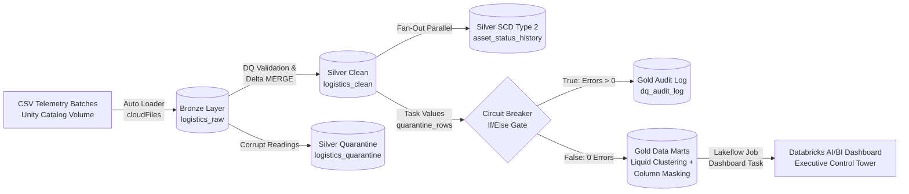

# 🚚 Smart Logistics & Cold-Chain Telemetry Lakehouse (Databricks)

Production-grade Data Engineering Lakehouse built on **Databricks** implementing the **Medallion Architecture (Bronze → Silver → Gold)**, governed by **Unity Catalog**, incremental ingestion via **Auto Loader**, automated **Data Quality Quarantine with Circuit Breaker routing**, **SCD Type 2** historical tracking, **Dynamic Column Masking**, an executive **Databricks AI/BI Dashboard**, and **Infrastructure as Code (Databricks Asset Bundles)**.

---

## 🏗️ End-to-End Architecture



---

## 🚀 Key Engineering Capabilities

* **Incremental Ingestion (Bronze):** **Auto Loader (`cloudFiles`)** with `trigger(availableNow=True)`, schema evolution, and file-level lineage metadata (`_source_file`, `_ingested_at`).
* **Data Quality Quarantine & Circuit Breaker:** Invalid sensor readings (out-of-range temperatures, null coordinates/IDs) are routed to `logistics_quarantine`. Using `dbutils.jobs.taskValues` and an `If/else` condition gate, the pipeline halts Gold updates and logs an audit incident whenever anomalies occur.
* **Historical State Tracking (SCD Type 2):** Tracks state transitions (`In Transit` → `Delayed` → `Delivered`) and inventory changes per asset with `effective_from`, `effective_to`, and `is_current` intervals via PySpark Window functions (`LAG`/`LEAD`).
* **Governance & Security (Unity Catalog):** Fine-grained access control using **Dynamic Column Masking** (`SET MASK`) to hide sensitive financial cargo values from unauthorized user groups, plus automated end-to-end **Data Lineage**.
* **Native BI Consumption (Databricks AI/BI Dashboard):** Connects directly to the Gold layer (`asset_performance_summary` and `operational_risk_alerts`) via a native **Databricks AI/BI Dashboard** (*Smart Logistics Executive Control Tower*), automatically refreshed as the final task of the **Lakeflow Job** while enforcing Unity Catalog column masks.
* **CI/CD & Infrastructure as Code:** Full workflow orchestration, schedules, and multi-environment targets (`dev` / `prod`) defined declaratively in **`databricks.yml`** using **Databricks Asset Bundles (DABs)**.

---

## 📂 Repository Structure

```text
databricks-smart-logistics-lakehouse/
├── databricks.yml                       # Databricks Asset Bundle (CI/CD & Job IaC)
├── docs/
│   ├── lakeflow_job_circuit_breaker.png # Conditional DAG execution
│   ├── unity_catalog_lineage.png        # End-to-end automated data lineage
│   └── databricks_aibi_dashboard.png    # Executive AI/BI Dashboard
└── src/
    ├── 01_setup_unity_catalog.sql       # Catalog, Medallion schemas & Volume setup
    ├── 02_bronze_autoloader.py          # Incremental CSV ingestion with Auto Loader
    ├── 03_silver_dq_and_merge.py        # Quarantine routing, Delta MERGE & Task Values
    ├── 04_gold_risk_analytics.sql       # Fleet KPIs & risk alerts (Liquid Clustering)
    ├── 05_dq_incident_logger.py         # Automated DQ incident audit logger
    ├── 06_silver_asset_scd2.py          # SCD Type 2 asset status history builder
    └── 07_unity_catalog_masking.sql     # Dynamic Column Masking for financial PII
```

---

## 📊 Pipeline Execution, Lineage & Executive BI

### Lakeflow Job Orchestration (Serverless)


### Unity Catalog End-to-End Lineage


### Databricks AI/BI Dashboard (Executive Control Tower)

