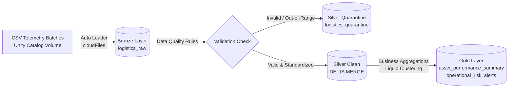

# 🚚 Smart Logistics & Cold-Chain Telemetry Lakehouse (Databricks)

End-to-end Data Engineering pipeline built on **Databricks** implementing the **Medallion Architecture (Bronze → Silver → Gold)**, governed by **Unity Catalog**, incremental ingestion via **Auto Loader**, automated **Data Quality Quarantine**, idempotent **Delta MERGE**, and orchestrated with **Lakeflow Jobs**.

---

## 🏗️ Architecture Overview



---

## 🛠️ Tech Stack & Engineering Decisions

* **Governance & Storage:** **Unity Catalog** (`logistics_prod` catalog, isolated schemas per Medallion layer, and Managed Volumes for raw landing files).
* **Incremental Ingestion (Bronze):** **Databricks Auto Loader (`readStream` + `cloudFiles`)** with `trigger(availableNow=True)` for cost-efficient batch streaming, schema inference/evolution, and file-level audit metadata (`_source_file`, `_ingested_at`).
* **Data Quality & Idempotency (Silver):**
  * **Quarantine Pattern:** Corrupt sensor readings (e.g., impossible temperatures `< -50°C` or `> 60°C`, null GPS coordinates) are isolated into `logistics_quarantine` with failure reasons instead of being silently dropped.
  * **Idempotent Upserts:** `DeltaTable.merge()` keyed on `(asset_id, event_timestamp)` prevents duplicate records across pipeline re-runs.
* **Analytics & Physical Optimization (Gold):** Business-ready tables optimized with **Liquid Clustering (`CLUSTER BY`)** to accelerate BI queries on fleet utilization, thermal excursions, and delay root causes.
* **Orchestration:** Automated DAG workflow managed via **Lakeflow Jobs** running on **Serverless Compute**.

---

## 📂 Repository Structure

```text
databricks-smart-logistics-lakehouse/
├── docs/
│   ├── lakeflow_job.png              # Orchestrated DAG execution
│   └── unity_catalog_lineage.png     # End-to-end automated data lineage
└── src/
    ├── 01_setup_unity_catalog.sql    # Catalog, Medallion schemas & Volume setup
    ├── 02_bronze_autoloader.py       # Incremental CSV ingestion with Auto Loader
    ├── 03_silver_dq_and_merge.py     # Quarantine routing, standardization & Delta MERGE
    └── 04_gold_risk_analytics.sql    # Fleet KPIs & thermal/delay risk alerts (Liquid Clustering)
```

---

## 📊 Pipeline Execution & Data Lineage

### Lakeflow Job Orchestration (Serverless)


### Unity Catalog End-to-End Lineage

